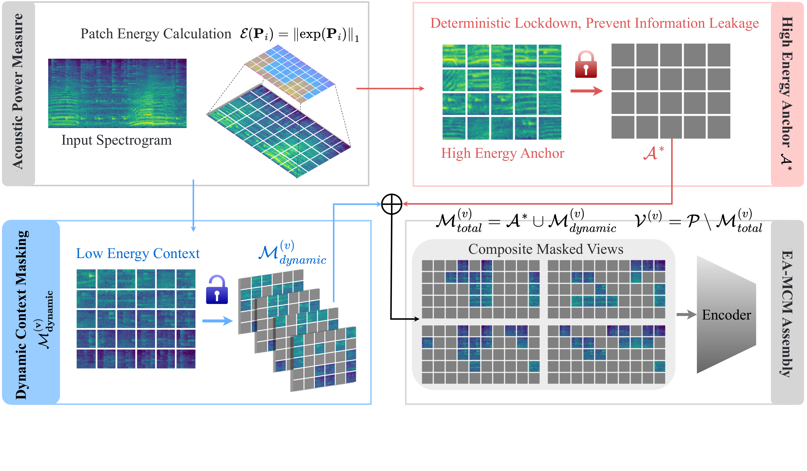
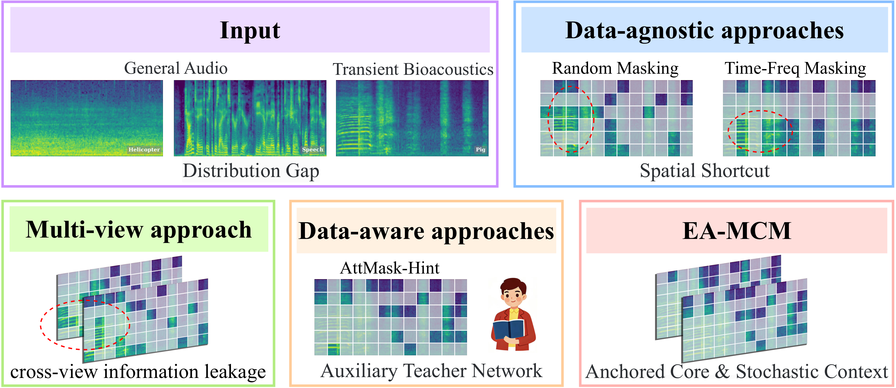
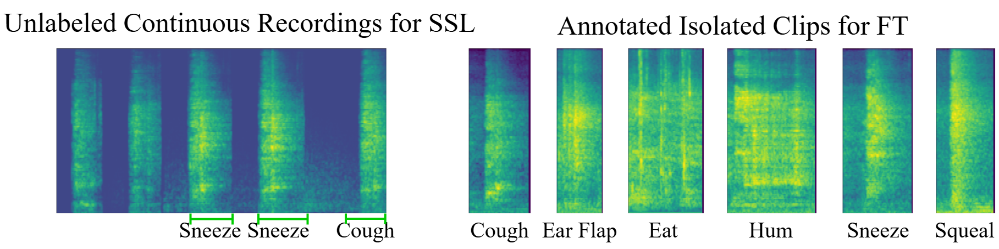
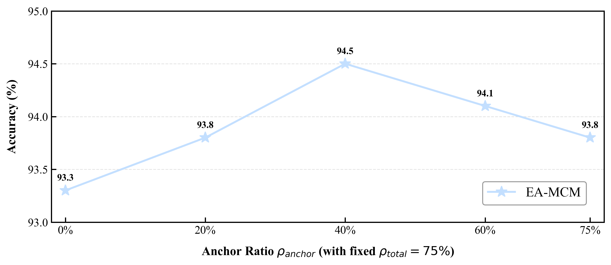
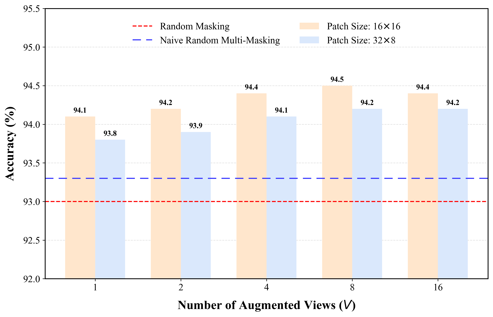
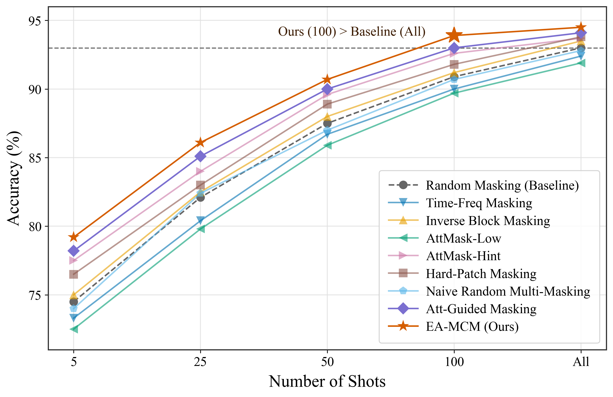

# EA-MCM: Energy-Anchored Multi-Context Masking for Transient Bioacoustics

[](https://2027.ieeeicassp.org/)
[](https://opensource.org/licenses/MIT)
[](https://www.python.org/downloads/)
[](https://pytorch.org/)

<sub>Official PyTorch implementation of *Beyond Random Masking: Energy-Anchored Contextual Representation Learning for Transient Bioacoustics*</sub>

> **Paper Status:** ICASSP 2027 Submission
> **Authors:** Xian Tang<sup>1,\*</sup>, Wei Cao<sup>1,\*</sup>, Jia Wang<sup>1,†</sup>
> <sup>1</sup> College of Informatics, Huazhong Agricultural University
> <sup>\*</sup> Equal contribution. <sup>†</sup> Corresponding author.

---

## Table of Contents

- [Recent Updates](#recent-updates)
- [Overview](#overview)
- [Method Overview](#method-overview)
- [Motivation](#motivation)
  - [1. Spatial Shortcut Learning](#1-spatial-shortcut-learning)
  - [2. Cross-View Information Leakage](#2-cross-view-information-leakage)
- [Method](#method)
  - [Step 1 — Energy-Driven Decoupling](#step-1--energy-driven-decoupling)
  - [Step 2 — Deterministic Anchor Lockdown](#step-2--deterministic-anchor-lockdown)
  - [Step 3 — Stochastic Ambient Masking](#step-3--stochastic-ambient-masking)
  - [Architecture Integration](#architecture-integration)
- [Experiments](#experiments)
  - [Table 1. Cross-Benchmark Evaluation](#table-1-cross-benchmark-evaluation)
  - [Table 2. Robustness and Orthogonality](#table-2-robustness-and-orthogonality)
  - [Table 3. Anchor Ratio × View Number Ablation](#table-3-anchor-ratio--view-number-ablation)
  - [Mechanism Validation](#mechanism-validation-spatial-shortcuts-are-systematically-eliminated)
  - [Few-Shot Generalization](#few-shot-generalization)
  - [Portability: Drop-In Masking Wrapper](#portability-drop-in-masking-wrapper)
- [Datasets](#datasets)
- [Quick Start](#quick-start)
  - [Requirements](#requirements)
  - [Installation](#installation)
  - [Data Preparation](#data-preparation)
  - [Self-Supervised Pre-Training](#self-supervised-pre-training)
  - [Downstream Fine-Tuning](#downstream-fine-tuning)
  - [Lightweight Evaluation Protocols](#lightweight-evaluation-protocols)
  - [Masking Visualization](#masking-visualization)
- [Reproducibility](#reproducibility)
- [Repository Structure](#repository-structure)
- [Citation](#citation)
- [Acknowledgements](#acknowledgements)
- [License](#license)

---

## Recent Updates

- **2026.10 — Initial release.** Full runnable source: model, 9 masking strategies, 6 benchmark dataset interfaces, complete training and evaluation toolchain, reference configs, and step-by-step reproduction commands.

---

## Overview

Porting audio foundation models to **transient bioacoustics** faces severe domain gaps and data scarcity. The dominant masked autoencoder (MAE) pre-training paradigm exhibits two structural flaws in this regime:

| Flaw | Mechanism | Consequence |
|------|-----------|-------------|
| **Spatial Shortcut Learning** | Data-agnostic masks frequently expose contiguous high-energy formant fragments. The strong local spectral continuity of physical signals allows the model to reconstruct masked patches via neighborhood interpolation or boundary extrapolation. | The encoder learns shallow spatial interpolation rather than global acoustic semantics. |
| **Cross-View Leakage** | Multi-view masks are sampled independently. The probability that a focal patch remains visible in *at least one* view is $1 - \rho_{total}^V$ — approximately 90% for $V=8$ and $\rho_{total}=75\%$. | The encoder aligns leaked focal features across views, bypassing the intended contextual inference task. |

**EA-MCM (Energy-Anchored Multi-Context Masking)** uses acoustic power as a physics prior to decompose the spectrogram into a **high-energy focal core** and a **low-energy ambient context**. The focal core is deterministically anchor-masked across all views (leakage probability is exactly zero by construction), while the ambient context is sampled stochastically per view. The entire pipeline requires only a closed-form $O(N\log N)$ energy sort — **no auxiliary teacher network** — achieving an **8× speedup** over teacher-guided masking strategies (5.1 ms/batch vs. 41.0–43.8 ms/batch) while delivering leading or tied downstream performance across all six benchmarks.

### Headline Results (P.A.S.T. Fine-Tuning Accuracy, n = 6 runs)

| Method | Data-Aware | Views | Mask Time ↓ | P.A.S.T. Acc ↑ |
|--------|:----------:|:-----:|:-----------:|:--------------:|
| Random Masking | ✗ | 1 | 1.5 ms | 93.04 ± 0.54 |
| AttMask-Hint | ✓ (Energy) | 1 | 43.8 ms | 93.70 ± 0.51 |
| Att-Guided Masking | ✓ (Semantic) | 1 | 41.0 ms | 94.22 ± 0.38 |
| Naive Random Multi-Masking | ✗ | 8 | 4.5 ms | 93.37 ± 0.52 |
| **EA-MCM (Ours)** | **✓ (Physics)** | **8** | **5.1 ms** | **94.65 ± 0.26** |

---

## Method Overview



> **EA-MCM overall pipeline.** Input spectrogram → acoustic power measure → high-energy anchor set $A^*$ (deterministically locked) + low-energy ambient context → dynamic context mask sampled per view → composite mask views fed into encoder-decoder.

### Masking Paradigm Comparison



> **Figure 1 — Three masking paradigms.** Data-agnostic methods (Random / Time-Freq) expose high-energy focal regions, creating spatial shortcuts. Data-aware methods (AttMask-Hint) rely on auxiliary teacher networks, incurring overhead. EA-MCM uses a physical energy prior to achieve "anchored core + random context", balancing quality and efficiency.

---

## Motivation

### 1. Spatial Shortcut Learning

Partition the log-Mel spectrogram $X \in \mathbb{R}^{T \times F}$ into $N$ patches. Under uniform random masking, the expected number of exposed patches within a high-energy formant cluster $H \subset \mathcal{P}$ is:

$$
\mathbb{E}\big[|H \cap V_{\text{rand}}|\big] = (1 - \rho_{\text{total}})\,|H| > 0 \qquad (1)
$$

Due to the strong local spectral continuity of physical acoustic signals, a masked high-energy patch $P_m$ can be directly extrapolated from a neighboring visible patch $P_v$ (Euclidean distance $d(P_m, P_v) < \epsilon$):

$$
\hat{P}_m \approx \mathcal{F}_{\text{extrapolate}}(P_v) \qquad (2)
$$

The network therefore minimizes reconstruction error through local interpolation — learning **spatial shortcuts** rather than global acoustic dependencies.



> **P.A.S.T. spectrogram examples.** Bioacoustic utterances manifest as sparse, high-energy time-frequency formant clusters surrounded by environmental noise or silence — the energy distribution is highly non-uniform, distinct from continuous speech or steady-state environmental sounds.

### 2. Cross-View Information Leakage

In a multi-view masking framework where $V$ mask views are generated per sample, if each view is sampled independently, the probability that a focal patch $P_k \in A^*$ is exposed in at least one view is:

$$
\mathbb{P}\Big(P_k \in \bigcup_{v=1}^{V} V_{\text{rand}}^{(v)}\Big) = 1 - \rho_{\text{total}}^V \;\to\; 1 \quad \text{as } V \to \infty \qquad (3)
$$

For $V=8$ and $\rho_{\text{total}} = 75\%$, this probability is approximately **90%**; for $V=16$ it reaches 99%. The encoder can therefore bypass the intended contextual inference task by correlating leaked focal signatures across views. The naive multi-view baseline (Naive Random Multi-Masking, $V=8$) only achieves 93.37% — below the expected improvement over single-view Random Masking — which is direct evidence of the leakage effect.

---

## Method

EA-MCM consists of three steps, all computed in closed form on the **raw (unnormalized) spectrogram**:

### Step 1 — Energy-Driven Decoupling

Apply the acoustic power operator to map each patch back to its linear spectral amplitude density:

$$
E(P_i) = \lVert \exp(P_i) \rVert_1, \quad i = 1, \dots, N \qquad (4)
$$

The per-sample global maximum is subtracted before exponentiation for numerical stability; because this shift is constant within a sample, the induced patch ranking — and therefore the anchor set — is mathematically identical to the unshifted formulation.

### Step 2 — Deterministic Anchor Lockdown

Select the set of patches with the largest cumulative energy under the strict cardinality constraint $K_{\text{anchor}} = \lfloor \rho_{\text{anchor}}\, N \rfloor$ as the anchor set:

$$
A^* = \operatorname*{arg\,max}_{A \subseteq \mathcal{P},\, |A| = K_{\text{anchor}}} \sum_{P_k \in A} E(P_k) \qquad (5)
$$

$A^*$ is unconditionally masked in **all** $V$ views — the cross-view focal leakage probability is **exactly zero by construction**.

### Step 3 — Stochastic Ambient Masking

The remaining patches form the ambient context $\Omega_{\text{context}} = \mathcal{P} \setminus A^*$. A dynamic context mask is sampled uniformly per view:

$$
M_{\text{dynamic}}^{(v)} \sim \mathcal{U}\big(\Omega_{\text{context}},\, K_{\text{dynamic}}\big), \quad K_{\text{dynamic}} = \lfloor (\rho_{\text{total}} - \rho_{\text{anchor}})\, N \rfloor \qquad (6)
$$

The composite mask combines both components:

$$
M_{\text{total}}^{(v)} = A^* \,\cup\, M_{\text{dynamic}}^{(v)}, \quad v = 1, \dots, V \qquad (7)
$$

Core implementation (see [eamcm/masking/ea_mcm.py](eamcm/masking/ea_mcm.py)):

```python
energy  = patch_energy(raw_fbank)                # E(P_i) = ||exp(P_i)||_1        (Eq. 4)
anchor  = topk_mask(energy, k_anchor)            # A*: high-energy focal core     (Eq. 5)
dynamic = topk_mask(noise.masked_fill(anchor, -1), k_dynamic)   # sample from Omega_context (Eq. 6)
masks   = [(anchor | dynamic).clone() for _ in range(V)]        # composite mask, shared anchor (Eq. 7)
```

### Architecture Integration

The Transformer encoder processes only visible tokens; a lightweight decoder minimizes MSE on the masked patches:

$$
\mathcal{L}_{\text{rec}} = \frac{1}{|M_{\text{total}}^{(v)}|} \sum_{P_i \in M_{\text{total}}^{(v)}} \lVert \hat{P}_i - P_i \rVert_2^2 \qquad (8)
$$

Because $A^*$ is invariant across views while the ambient context varies stochastically, this objective forces the encoder to infer the missing vocalization core from **physically coupled contextual cues** such as respiratory precursors and structural reverberation. After pre-training, the decoder is discarded and the encoder tokens are transferred downstream via global average pooling (GAP).

---

## Experiments

All metrics are reported as **mean ± 95% CI over 6 independent runs** (n = 6). Pre-training data: AudioSet → P.A.S.T. (two-stage SSL). Unified ViT-Base / Audio-MAE architecture, 128-band log-Mel, 16×16 patches (64×8 grid = 512 tokens).

### Table 1. Cross-Benchmark Evaluation

| Base Model / Masking Strategy | Pre-Train | Data-Aware | Views ($V$) | Mask Time ↓ | P.A.S.T. Acc ↑ | SPC-2 Acc ↑ | ESC-50 Acc ↑ | AS-20K mAP ↑ | BirdSet cmAP ↑ | WMM Mac-F1 ↑ |
|-------------------------------|-----------|:----------:|:-----------:|:-----------:|:--------------:|:-----------:|:------------:|:------------:|:--------------:|:------------:|
| **(A) Large-Scale Foundation Baselines** | | | | | | | | | | |
| AST | IN+AS | – | – | – | 87.4 | 96.2 | 89.7 | 30.6 | 35.6 | 91.0 |
| Audio-MAE | AS | – | – | – | 90.2 | 97.8 | 94.8 | 37.8 | 37.7 | 91.7 |
| BEATs (iter3) | AS | – | – | – | 91.5 | 98.3 | 95.8 | 41.8 | 38.1 | 93.5 |
| **(B) In-Domain SSL Pre-Training (Single-View)** | | | | | | | | | | |
| Random Masking | AS→P.A.S.T. | ✗ | 1 | 1.5 | 93.04 ± 0.54 | 97.81 ± 0.32 | 94.82 ± 0.41 | 38.13 ± 0.65 | 38.22 ± 0.92 | 91.82 ± 0.95 |
| Time-Freq Masking | AS→P.A.S.T. | ✗ | 1 | 2.4 | 92.24 ± 0.61 | 98.21 ± 0.24 | 94.75 ± 0.45 | 38.40 ± 0.72 | 38.73 ± 0.41 | 92.50 ± 1.21 |
| Inverse Block Masking (EAT) | AS→P.A.S.T. | ✗ | 1 | 2.1 | 93.51 ± 0.48 | 97.91 ± 0.31 | 95.35 ± 0.38 | 38.94 ± 0.58 | 38.66 ± 0.56 | 92.47 ± 0.89 |
| AttMask-Low | AS→P.A.S.T. | ✓ (Energy) | 1 | 43.7 | 92.16 ± 0.59 | 97.69 ± 0.35 | 94.31 ± 0.47 | 38.33 ± 0.69 | 39.11 ± 0.76 | 92.25 ± 0.63 |
| AttMask-Hint | AS→P.A.S.T. | ✓ (Energy) | 1 | 43.8 | 93.70 ± 0.51 | 98.22 ± 0.29 | 95.48 ± 0.36 | 38.85 ± 0.60 | 40.11 ± 0.37 | 94.31 ± 0.38 |
| Hard-Patch Masking | AS→P.A.S.T. | ✓ (Loss) | 1 | 35.4 | 93.86 ± 0.44 | 98.17 ± 0.27 | 95.41 ± 0.33 | 39.03 ± 0.55 | 39.53 ± 0.45 | 93.39 ± 1.14 |
| Att-Guided Masking | AS→P.A.S.T. | ✓ (Semantic) | 1 | 41.0 | 94.22 ± 0.38 | 98.23 ± 0.22 | 95.63 ± 0.29 | 39.11 ± 0.48 | 40.08 ± 0.68 | 94.27 ± 0.71 |
| **(B) In-Domain SSL Pre-Training (Multi-View)** | | | | | | | | | | |
| Naive Random Multi-Masking | AS→P.A.S.T. | ✗ | 8 | 4.5 | 93.37 ± 0.52 | 98.04 ± 0.28 | 95.12 ± 0.39 | 38.76 ± 0.61 | 39.40 ± 0.68 | 93.41 ± 0.65 |
| **EA-MCM (Ours)** | AS→P.A.S.T. | **✓ (Physics)** | **8** | **5.1** | **94.65 ± 0.26** | **98.61 ± 0.19** | **95.91 ± 0.25** | **39.14 ± 0.10** | **40.53 ± 0.23** | 94.13 ± 0.47 |

**Key findings:**

- **Beyond data-agnostic baselines.** EA-MCM achieves 94.65% vs. Random Masking's 93.04% (**+1.61%**) and Inverse Block's 93.51% (**+1.14%**) — geometric masks leave contiguous formant fragments, letting the encoder exploit local interpolation shortcuts.
- **8× computational advantage.** Teacher-guided methods (AttMask-Hint 43.8 ms, Att-Guided 41.0 ms /batch) are bottlenecked by auxiliary forward passes; EA-MCM needs only 5.1 ms/batch — the closed-form $O(N\log N)$ energy sort eliminates auxiliary network dependencies entirely while delivering higher accuracy.
- **Cross-domain universality of physics priors.** Best BirdSet cmAP of 40.53% (**+2.31%** over Random); on WMM's low-SNR continuous-harmonic regime, EA-MCM reaches 94.13% Macro-F1, tied with the heavy semantic mask (Att-Guided 94.27%).

### Table 2. Robustness and Orthogonality (P.A.S.T. Fine-Tuning Accuracy %)

> Additive noise from FSD50K at 0 dB SNR: Fan (broadband), Buzz (harmonic mechanical), Boom (impulsive transient).

| FT Paradigm | Masking Strategy | No Noise | Fan | Buzz | Boom |
|------------|-----------------|:--------:|:---:|:----:|:----:|
| **Group 1: Standard Fine-Tuning** | Random | 93.0 | 83.2 | 82.5 | 75.4 |
| | Inverse Block | 93.5 | 84.6 | 84.3 | 78.2 |
| | **EA-MCM** | **94.6** | **85.8** | **84.9** | **79.1** |
| **Group 2: + SpecAugment** | Random | 93.9 | 85.6 | 86.2 | 77.9 |
| | Inverse Block | 94.6 | 87.5 | 87.1 | 82.3 |
| | **EA-MCM** | **95.4** | **88.6** | **88.3** | **83.9** |
| **Group 3: + Audio Mixup** | Random | 94.1 | 85.3 | 83.6 | 78.5 |
| | Inverse Block | 94.8 | 88.2 | 87.5 | 83.2 |
| | **EA-MCM** | **95.5** | **89.7** | **88.8** | **84.3** |

- **Impulsive noise robustness.** Random Masking drops 17.6% under Boom to 75.4%; EA-MCM holds at **79.1%** — the training objective of inferring vocalization cores from contextual precursors prevents the network from confounds between external impulsive bursts and intrinsic biological formants.
- **Orthogonality with standard augmentations.** Gains compound with SpecAugment / Mixup, peaking at **95.5%**, confirming that energy-anchored structural representations and input-space perturbations are independent.

### Table 3. Anchor Ratio × View Number Ablation (P.A.S.T. Macro-F1 %)

| $\rho_{\text{anchor}}$ | V = 2 | V = 4 | V = 8 | V = 16 |
|:----------------------:|:-----:|:-----:|:-----:|:------:|
| $\rho_{\text{anchor}} = 0.1$ | 91.43 ± 0.83 | 91.89 ± 0.79 | 92.22 ± 0.53 | 92.43 ± 0.64 |
| $\rho_{\text{anchor}} = 0.2$ | 92.17 ± 0.68 | 92.54 ± 0.71 | 92.87 ± 0.50 | 92.91 ± 0.75 |
| **$\rho_{\text{anchor}} = 0.4$** | 92.46 ± 0.36 | 93.03 ± 0.44 | **93.23 ± 0.31** | 93.11 ± 0.56 |
| $\rho_{\text{anchor}} = 0.6$ | 92.08 ± 0.59 | 92.47 ± 0.26 | 92.72 ± 0.34 | 92.58 ± 0.44 |



> **Supplementary Figure 1 — $\rho_{\text{anchor}}$ sensitivity** ($\rho_{\text{total}} = 75\%$ fixed). Inverted-U phase transition: 0% (collapses to naive multi-view random masking) → **peak at 40% (94.65%)** → 75% (context pool exhausted, 93.80%).

- **Direct evidence of the leakage bottleneck.** At $\rho_{\text{anchor}} = 0$, even $V=16$ yields only 92.43% — the theoretical focal leakage probability $1 - 0.75^{16} \approx 99.0\%$ reduces the reconstruction task to trivial cross-view feature alignment.
- **Performance peaks at $\rho_{\text{anchor}} = 40\%$, $V = 8$**, which covers the dominant formants while the dynamic mask retains sufficient ambient context (35% visible patches); $\rho_{\text{anchor}} = 60\%$ deprives causal context, dropping to 92.72%.



> **Supplementary Figure 2 — Patch size × view number ablation.** Symmetric 16×16 patches outperform stretched 32×8 configuration across all view counts — isotropic patches preserve the 2D local structure of harmonic resonance and frequency sweeps across both time and frequency axes.

### Mechanism Validation: Spatial Shortcuts Are Systematically Eliminated

| Experiment | Naive Multi-View | EA-MCM |
|-----------|:----------------:|:------:|
| Masked / unmasked patch MSE ratio (frozen-encoder probe) | 1.29 (skewed by neighborhood interpolation) | **1.02 (near-uniform)** |
| Reversed mask polarity (expose high-energy bursts, occlude low-energy context) | — | Accuracy drops to 91.9%, worst-class recall 64.2% (−3.1%) |

The reversed-polarity experiment confirms that **exposed high-energy peaks themselves constitute shortcuts**; the MSE ratio equalization from 1.29 to 1.02 provides quantitative evidence that spatial shortcuts are eliminated.

### Few-Shot Generalization (Figure 3)



- Under **extreme scarcity of 5 shots per class**, EA-MCM still reaches **79.2%** (**+4.7%** over Random Masking).
- At **100 shots per class**, EA-MCM reaches **94.0%** — exceeding Random Masking trained with **all** annotated data (93.04%).
- **Linear probe.** Random Masking suffers representation collapse on the rarest Hum class (Min-Rec 66.3%, mF1 87.4%); EA-MCM lifts Min-Rec to **72.6%** and mF1 to **89.7%**.

### Portability: Drop-In Masking Wrapper (Supplementary Table C)

| SSL Backbone | Configuration | P.A.S.T. Macro-F1 | BirdSet cmAP |
|--------------|---------------|:-----------------:|:------------:|
| Bird-MAE (Rauch et al. 2025) | Default random masking | 93.91 | 50.92 |
| | **+ EA-MCM** | **94.84 ± 0.38** | **52.12 ± 0.44** |
| iNat-MAE (Liu et al. 2026) | Default random masking | 94.35 | 52.22 |
| | **+ EA-MCM** | **95.07 ± 0.31** | **53.35 ± 0.38** |

EA-MCM is completely parameter-free and operates directly on the raw spectral space without modifying the backbone's weights, tokenizer, or pooling mechanism — as a **modular, drop-in masking wrapper**, it integrates seamlessly into any domain-specific SSL framework.

---

## Datasets

### P.A.S.T. (Porcine Audio for Semantic and Transient Understanding)

Collected on active commercial farms (*Sus scrofa domesticus*) with continuous mechanical hum, structural percussion, and ventilation noise in the environment:

| Partition | Scale | Purpose |
|-----------|-------|---------|
| Unlabeled pool | 610 continuous recordings ≈ 30 h | Self-supervised pre-training |
| Labeled core | 1,440 segments, 6 long-tail classes (avg. 1.2 s) | Downstream evaluation |

- **6 classes:** `cough` / `sneeze` / `earflap` / `eat` / `squeal` / `hum`
- Dual independent expert annotation + third-expert arbitration for disagreements
- **Session-level 8:1:1 split:** Continuous recording blocks (sessions) captured with a fixed microphone setup are assigned as atomic units to a single split, preventing leakage from reverberation profiles, individual vocal tracts, or mechanical periodicity
- **SNR characteristics:** Vocalizations are high-SNR transient events at +12 ~ +25 dB (contrast: WMM is low-SNR continuous harmonics at 0 ~ −10 dB, constituting a rigorous stress test for the energy heuristic)

### Six Benchmarks Overview

| Dataset | Domain | Task | Sample Rate | Total Duration | Avg. Duration | Split Protocol |
|---------|--------|------|-------------|----------------|---------------|----------------|
| P.A.S.T. | Porcine transient vocalizations | 6-class multi-label | 16 kHz | 30 h (unlabeled) | 1.2 s | Session-isolated |
| BirdSet (2025) | Birds (fine-grained) | Multi-label cmAP | 32 kHz | 82 h | 5.0 s | Standard train/val/test |
| WMM (2016) | Marine mammals | Multi-class Macro-F1 | 48 kHz | 15 h | 2.5 s | Species-disjoint |
| AS-20K (2017) | General env. / music | Multi-label mAP (527 classes) | 16 kHz | 57 h | 10.0 s | Class-balanced subset |
| ESC-50 (2015) | Environmental sounds | 50-class multi-label | 44.1 kHz | 2.7 h | 5.0 s | 5-fold cross-validation |
| SPC-2 (2018) | Human speech transient | 35-word keyword spotting | 16 kHz | 29.4 h | 1.0 s | Standard train/val/test |

---

## Quick Start

### Requirements

```bash
Python >= 3.8
PyTorch >= 2.0
torchaudio >= 2.0
numpy >= 1.24
matplotlib >= 3.7   # masking visualization
soundfile >= 0.12   # audio I/O backend fallback (Windows without FFmpeg)
```

### Installation

```bash
git clone https://github.com/youshou1dknowme9320-maker/EA-MCM.git
cd EA-MCM
pip install -e .                # installs as a package so `import eamcm` works from anywhere
pip install -r requirements.txt # explicit pinning (optional)
```

### Data Preparation

All datasets interface through a unified manifest CSV (columns: `filepath,label[,fold]`):

```bash
# 1) P.A.S.T. labeled core: class-per-directory audio tree → manifest
python tools/prepare_manifests.py folder --root data/past/clips --out data/past/manifest.csv

# 2) Session-level 8:1:1 split (prevents acoustic profile leakage across splits)
python tools/split_past_sessions.py --manifest data/past/manifest.csv \
    --train-out data/past/train.csv --val-out data/past/val.csv --test-out data/past/test.csv

# 3) P.A.S.T. unlabeled pool (for SSL pre-training)
python tools/prepare_manifests.py unlabeled --root data/past/continuous --out data/past/unlabeled.csv

# 4) ESC-50 (official metadata, preserves 5-fold split)
python tools/prepare_manifests.py esc50 --meta ESC-50-master/meta/esc50.csv \
    --audio-root ESC-50-master/audio --out data/esc50/manifest.csv

# 5) Multi-label datasets (AS-20K / BirdSet): class names → integer ids
python tools/prepare_manifests.py multi-csv --meta as20k.csv --out data/as20k/manifest.csv \
    --labels-out data/as20k/labels.json --sep ","
```

### Self-Supervised Pre-Training (Table 1, Group B)

```bash
# EA-MCM (paper defaults: rho_total=75%, rho_anchor=40%, V=8, AdamW, 300 epochs)
python tools/pretrain.py --strategy ea_mcm \
    --manifest data/past/unlabeled.csv \
    --init-checkpoint ckpt/audiomae_audioset.pth \
    --epochs 300 --batch-size 128 --num-views 8 \
    --output-dir work_dirs/pretrain_eamcm

# Any baseline strategy (9 registered strategies)
python tools/pretrain.py --strategy random --num-views 1 \
    --manifest data/past/unlabeled.csv --output-dir work_dirs/pretrain_random
python tools/pretrain.py --strategy naive_random_multimasking --num-views 8 \
    --manifest data/past/unlabeled.csv --output-dir work_dirs/pretrain_naive_mv
python tools/pretrain.py --strategy attmask_hint --teacher-source energy \
    --manifest data/past/unlabeled.csv --output-dir work_dirs/pretrain_attmask

# Supplementary Sec. B.2: stretched-patch ablation (32 mel × 8 frame)
python tools/pretrain.py --strategy ea_mcm --stretched-patch ...
```

Available strategies: `random` / `time_freq` / `inverse_block` / `attmask_low` / `attmask_hint` / `hard_patch` / `att_guided` / `naive_random_multimasking` / `ea_mcm`

### Downstream Fine-Tuning (Table 1 / Table 2)

```bash
# Main protocol: 6 independent runs, mean ± 95% CI
python tools/finetune.py --dataset past \
    --train-manifest data/past/train.csv --val-manifest data/past/val.csv \
    --test-manifest data/past/test.csv \
    --pretrained work_dirs/pretrain_eamcm/encoder_last.pth \
    --runs 6 --seed 42

# Table 2 orthogonality studies
python tools/finetune.py --dataset past ... --specaugment   # Group 2
python tools/finetune.py --dataset past ... --mixup         # Group 3

# Other benchmarks (dataset choices: past / esc50 / spc2 / wmm / as20k / birdset)
python tools/finetune.py --dataset esc50 --train-manifest data/esc50/manifest.csv \
    --test-manifest data/esc50/manifest.csv --fold 1 \
    --pretrained work_dirs/pretrain_eamcm/encoder_last.pth --runs 6
```

### Lightweight Evaluation Protocols

```bash
# Linear probe (frozen encoder + cached GAP features, linear head only)
python tools/linear_probe.py --dataset past \
    --train-manifest data/past/train.csv --test-manifest data/past/test.csv \
    --pretrained work_dirs/pretrain_eamcm/encoder_last.pth --runs 6

# Few-shot (Figure 3): K ∈ {5, 25, 50, 100, All}
python tools/few_shot.py --dataset past \
    --train-manifest data/past/train.csv --test-manifest data/past/test.csv \
    --pretrained work_dirs/pretrain_eamcm/encoder_last.pth \
    --shots 5,25,50,100,0 --runs 6

# Robustness (Table 2 Group 1 noise columns): FSD50K Fan/Buzz/Boom @ 0 dB SNR
python tools/robustness_eval.py --dataset past \
    --test-manifest data/past/test.csv \
    --checkpoint work_dirs/finetune/run0_best.pth \
    --noise-dir data/fsd50k/interference --noise-types clean,fan,buzz,boom
```

### Masking Visualization (Demo Figures)

```bash
# Generate masking strategy comparison panels: view masks + cross-view exposure map
# (leakage visualization) + EA-MCM anchor set
python tools/visualize_mask.py --audio data/past/clips/session_01/clip_0007.wav \
    --strategies random naive_random_multimasking ea_mcm --output figures/mask_vis
```

Multi-view strategies additionally render a **cross-view exposure map** (fraction of views in which each patch remains visible): naive multi-view masks approach exposure → 1 in focal regions (leakage), while EA-MCM's anchor set has exposure **exactly 0**.

---

## Reproducibility

- **Statistical protocol.** All main-table metrics are mean ± 95% CI over 6 independent runs. The toolchain ships `--runs 6`; the CI half-width is $1.96 \cdot \sigma / \sqrt{n}$.
- **Few-shot sampling.** Shot sampling is fixed per run seed; with a fixed `--seed`, all pre-trained encoders are evaluated on **identical** shot sets.
- **ESC-50.** 5-fold cross-validation; the training fold is the remaining four (`--fold` specifies the held-out fold).
- **Session isolation.** `tools/split_past_sessions.py` treats session as the minimum split unit — clips from the same session never straddle train / val / test.
- **Determinism.** Masking sampling supports an independent random generator (`seed_generator`); energy ranking is deterministic closed-form.
- **Reference configs.** [configs/pretrain_past.yaml](configs/pretrain_past.yaml) and [configs/finetune_past.yaml](configs/finetune_past.yaml) record the paper's default hyper-parameters; `tools/*.py` are CLI-driven with numerically identical values.

---

## Repository Structure

```
EA-MCM/
├── eamcm/
│   ├── __init__.py
│   ├── masking/                # 9 masking strategies: EA-MCM + 8 baselines (unified List[(B,N) bool] interface)
│   │   ├── base.py             #   Base class + acoustic power operator patch_energy (Eq. 4)
│   │   ├── ea_mcm.py           #   EA-MCM / Naive Random Multi-Masking
│   │   ├── random.py           #   Random / Time-Freq / Inverse Block (EAT)
│   │   ├── attmask.py          #   AttMask-Low/Hint / Hard-Patch / Att-Guided
│   │   └── registry.py         #   Name-based construction + seed generator
│   ├── models/
│   │   ├── vit.py              #   ViT components (attention rollout supported for teacher strategies)
│   │   └── mae_audio.py        #   Audio-MAE ViT-Base (asymmetric decoder 512/4/16, norm_pix_loss) + classification head
│   ├── datasets/               #   P.A.S.T. / BirdSet / WMM / AS-20K / ESC-50 / SPC-2 + K-shot datasets
│   └── utils/                  #   Audio front-end (Kaldi fbank 25 ms / 10 ms), metrics, optimizer/schedule, augmentation & noise injection
├── tools/
│   ├── pretrain.py             #   SSL pre-training (9-strategy CLI, reports ms/batch)
│   ├── finetune.py             #   Downstream fine-tuning (n=6 runs, mean±CI, SpecAugment/Mixup orthogonality)
│   ├── linear_probe.py         #   Linear probing (feature caching)
│   ├── few_shot.py             #   Few-shot evaluation (Figure 3)
│   ├── robustness_eval.py      #   FSD50K additive-noise robustness (Table 2)
│   ├── visualize_mask.py       #   Mask / exposure map visualization (demo)
│   ├── prepare_manifests.py    #   Manifest construction (folder/csv/esc50/multi-csv/unlabeled)
│   ├── split_past_sessions.py  #   Session-level 8:1:1 split
│   └── common.py               #   Dataset spec table, evaluation loop, shared utilities
├── configs/                    #   Reference configs (paper default hyper-parameters)
├── tests/                      #   18 unit tests (mask budget / anchor set / leakage, front-end, model)
├── figures/                    #   Paper figures + masking visualization demos
├── pyproject.toml              #   Package metadata (pip install -e .)
├── requirements.txt
└── LICENSE
```

---

## Citation

```bibtex
@inproceedings{tang2026eamcm,
  title     = {Beyond Random Masking: Energy-Anchored Contextual Representation
               Learning for Transient Bioacoustics},
  author    = {Tang, Xian and Cao, Wei and Wang, Jia},
  booktitle = {IEEE International Conference on Acoustics, Speech and Signal
               Processing (ICASSP)},
  year      = {2026}
}
```

---

## Acknowledgements

This research was supported by IRIFH202209 (Yingzi Technology & Huazhong Agricultural University Food and Health Intelligent Research Institute) and Guangxi Key R&D Program (No. 2025JBGS042). We thank the authors of Audio-MAE, EAT, AttMask, Hard Patches Mining, BirdSet, Watkins Marine Mammal Database, ESC-50, Speech Commands, and AudioSet for their open-source contributions.

---

## License

This project is released under the [MIT License](LICENSE).
